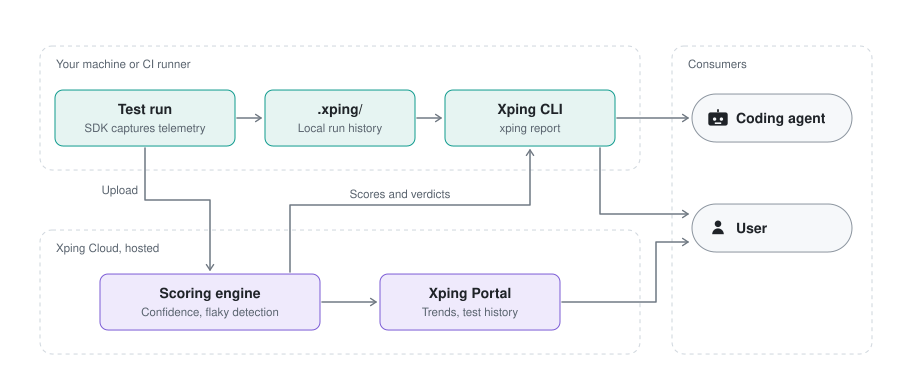

<div id="top"></div>

<div align="center">
  <p align="center">
    <a href="https://www.nuget.org/packages/Xping.Sdk.Core/"></a>
    <a href="https://www.nuget.org/packages/Xping.Cli/"></a>
    <a href="https://github.com/xping-dev/sdk-dotnet/actions/workflows/ci.yml"></a>
    <a href="https://codecov.io/gh/xping-dev/sdk-dotnet"></a>
    <a href="https://opensource.org/licenses/MIT"></a>
  </p>
  
  <h1>Xping for .NET</h1>
  <p align="center">
    <strong>Your coding agent can't tell a flaky test from a broken one.</strong>
    <br />
    Xping records every <code>dotnet test</code> run, including the runs on your own machine,
    so you can judge a test from its history instead of from one red run.
    <br />
    <sub>Recording and local reports are free. They need no account and make no network calls.</sub>
  </p>
</div>

<div align="center">
  <p align="center">
    <a href="#quick-start"><strong>Quick start</strong></a> •
    <a href="#local-and-xping-cloud"><strong>Local and Xping Cloud</strong></a> •
    <a href="#how-it-works"><strong>How it works</strong></a> •
    <a href="https://docs.xping.io"><strong>Documentation</strong></a> •
    <a href="https://docs.xping.io/troubleshooting/known-limitations.html"><strong>Known limitations</strong></a> •
    <a href="https://github.com/xping-dev/sdk-dotnet/issues"><strong>Report a bug</strong></a>
  </p>
</div>

<br />

---

## Why history matters

A single test run cannot tell a flaky test from a real failure. Both look the same: one red result.

When you, or a coding agent, fix a test from one red run, the usual fixes hide the problem:

| The fix | The result |
| ------- | ---------- |
| Loosen the assertion | The test runs, but it no longer checks the thing that broke. |
| Add a retry | A real failure that you can reproduce passes on the third attempt. |
| Increase the timeout | The race condition is still there. It happens less often, so it is harder to find in CI. |
| Move the test into its own `[Collection]` | The tests run one after another. The shared-state bug is still there, and every build is slower. |
| Mock the dependency that failed | The test always passes, because it no longer runs the code that broke. |

Each of these fixes makes sense when you have only one run. Xping keeps the history of every run.
The SDK records each test execution with its outcome, duration and environment. The CLI reads
that history and reports which tests behaved consistently and which did not: as text for you, and
as JSON for your agent. Your test code does not change.

---

## Two ways to run Xping

|                | **Local** | **Xping Cloud** |
| -------------- | --------- | --------------- |
| **Setup**      | SDK package and CLI tool | Also an API key with the Upload scope |
| **Account**    | Not needed | Needed ([by invitation](#connect-to-xping-cloud)) |
| **Your data**  | Stays in `.xping/` in your repository | Uploaded to Xping Cloud |
| **History**    | Your machine, your runs | Every machine and branch, CI included |
| **You get**    | Observations and evidence from local runs | Confidence scores, evidence levels, flaky detection, trends, PR comments |

**Start locally.** Nothing leaves your machine. You can add an API key later without changing
your test code.

---

## Quick start

### 1. Install the SDK and the CLI

```bash
dotnet add package Xping.Sdk.XUnit --prerelease    # xUnit v2. Or Xping.Sdk.XUnit.V3, Xping.Sdk.NUnit, Xping.Sdk.MSTest

dotnet tool install -g Xping.Cli --prerelease      # adds the xping command to your PATH
```

All Xping packages are prereleases, so each install command needs `--prerelease`. For xUnit, pick
the adapter that matches your xUnit package: `xunit` (v2) takes `Xping.Sdk.XUnit`, and `xunit.v3`
takes `Xping.Sdk.XUnit.V3`.

The SDK records each run, and the CLI reads what it recorded. You need both.

> The CLI needs the .NET 10 SDK or runtime. Your test projects can target .NET Framework 4.6.2 or
> later, or .NET 8 or later. The MSTest adapter needs MSTest 3.8 or later.

### 2. Turn on tracking

**xUnit**: add one line to `AssemblyInfo.cs`:

```csharp
[assembly: TestFramework("Xping.Sdk.XUnit.XpingTestFramework", "Xping.Sdk.XUnit")] // xUnit v2
// [assembly: TestFramework(typeof(Xping.Sdk.XUnit.V3.XpingTestFramework))]       // xUnit v3
```

**NUnit**: add one file. It tracks every test in the assembly, and its setup fixture starts and
ends the Xping session:

```csharp
using System.Threading.Tasks;
using NUnit.Framework;
using Xping.Sdk.NUnit;

[assembly: XpingTrack]

[SetUpFixture]
public class XpingSetup
{
    [OneTimeSetUp]
    public void BeforeAllTests() => XpingContext.Initialize();

    [OneTimeTearDown]
    public async Task AfterAllTests() => await XpingContext.FinalizeAndShutdownAsync();
}
```

Keep the `[OneTimeTearDown]` method. The SDK writes the run when the session ends, and without
this method the session never ends.

**MSTest**: add one class that starts and ends the Xping session, and make your test classes
inherit from `XpingTestBase`:

```csharp
using System.Threading.Tasks;
using Microsoft.VisualStudio.TestTools.UnitTesting;
using Xping.Sdk.MSTest;

[TestClass]
public static class XpingSetup
{
    [AssemblyInitialize]
    public static void AssemblyInit(TestContext context) => XpingContext.Initialize();

    [AssemblyCleanup]
    public static async Task AssemblyCleanup() => await XpingContext.FinalizeAndShutdownAsync();
}

[TestClass]
public class MyTests : XpingTestBase { }
```

### 3. Run your tests several times

```bash
dotnet test
```

Each run adds to the history. One run says nothing about reliability, so `xping report` shows no
findings until it has at least **5 runs**, and each test needs at least 5 runs of its own. Run your
tests as you normally do. The runs on your own machine count too.

### 4. Read the report

```bash
xping report
```

<!-- xping:sample docs-mstest -->
````
Xping · SampleApp.MSTest · 9 runs · 2026-08-20 07:52 → 09:02 · main@bdbafba
17 tests · 14 healthy · 3 flagged

```
NEEDS ATTENTION (4 high)                               most severe first
────────────────────────────────────────────────────────────────────────

1.  HIGH  flaky
    SampleTests.FlakyTest_PassesOnRetry
    failed 9 of 18 executions (50%) in 9 of 9 runs, 1 failure mode
    evidence adequate | -env-cluster | f_2b84a621 | ...SampleTests.cs:96

2.  HIGH  masked by retry                                same test as #1
    SampleTests.FlakyTest_PassesOnRetry
    passed on retry 9 times in 9 of 9 runs, up to attempt 2
    evidence adequate | -env | f_e98db1e6 | .../SampleTests.cs:96

3.  HIGH  always failing
    SampleTests.ThrowingTestIsTracked
    failed 9 of 9 executions (100%), one failure mode:
    System.InvalidOperationException
    evidence sparse | -env-cluster | f_c1774d82 | .../SampleTests.cs:65

4.  HIGH  flaky
    SampleTests.FlakyTest_RaceCondition_FailsIntermittently
    failed 4 of 9 executions (44.4%) in 4 of 9 runs, 1 failure mode
    evidence sparse | -env-cluster | f_d24c5aa9 | .../SampleTests.cs:118
```

rates: the marker on each finding says which runs its percentage was
counted out of; compare two only where the markers match.
https://docs.xping.io/cli/reading-the-report.html#the-population-marker

Detail of row 1: xping report --id f_2b84a621 --assembly SampleApp.MSTest
````

No API key, no account and no network calls. The history stays in `.xping/` on your machine.

[Run without an account →](https://docs.xping.io/getting-started/local-first.html)

### Guides for each framework

- [Quick start: NUnit](https://docs.xping.io/getting-started/quickstart-nunit.html): attributes, filtering and configuration
- [Quick start: xUnit](https://docs.xping.io/getting-started/quickstart-xunit.html): the test framework setup for xUnit v2 and v3
- [Quick start: MSTest](https://docs.xping.io/getting-started/quickstart-mstest.html): the base class and the assembly setup

---

## CLI commands

```bash
xping report                    # findings from recent runs
xping report --format json      # versioned JSON, for a script or an agent
xping report --summary          # one line per assembly, for a chat message or a CI step title
xping report --fail-on high     # exit with code 1 when any assembly has a high finding
xping report --runs 50          # a larger window (or --since <sha|yyyy-MM-dd>)
xping report --assembly Shop.Tests --kind flaky   # one assembly, one or more finding kinds
xping report --id f_445c562e    # one finding in detail, by the id on its row
xping report --test Login       # the history of one test, run by run
xping where                     # where the local runs are stored
xping clear                     # delete recorded runs
xping login                     # sign in to Xping Cloud from your browser
xping logout                    # sign out and remove the stored sign-in
xping auth status               # which Xping Cloud credential the CLI uses
```

With several test projects, `xping report` prints one row per assembly, most severe first.
`--assembly <name>` opens the full report of one assembly. When the store holds several
assemblies, `--top`, `--all` and `--kind` need it.
[Scoping →](https://docs.xping.io/cli/command-reference.html#scoping)

`xping report --help` lists the other options, such as `--directory`, `--ascii` and `--no-color`.

---

## Use with a coding agent

`xping report --format json` returns versioned JSON: the findings, their evidence levels, the run
counts and the failure modes. An agent can use it like this:

1. **The agent finds a failing test.** Before it changes the assertion, it asks Xping for the
   history of that test.
2. **Xping returns the evidence.** For example: failed in 34 of 34 runs, one failure mode,
   evidence robust. Or: failed in 4 of 40 runs, three failure modes.
3. **The agent decides.** A test that fails the same way in every run probably found a real bug,
   so the agent fixes the code and keeps the test. One local failure after a long series of passes
   may be noise, so the agent runs the test again before it changes anything.

The report gives evidence, not a verdict. The agent still makes the decision.

To use it, pass the `--format json` output to your agent. A dedicated skill and an MCP server are
[on the roadmap](#roadmap).

---

## Local and Xping Cloud

The local CLI reports **what it observed**. It does not give a test a score, and it does not name
a cause. A few runs on one machine are not enough evidence for that. Xping Cloud scores tests,
because it has the history of many machines, branches and CI jobs.

|                                        | Local | Xping Cloud |
| -------------------------------------- | :---: | :---: |
| Pass and fail history, run by run       | ✓ | ✓ |
| Tests that pass and fail inconsistently | ✓ | ✓ |
| Tests that fail in every run            | ✓ | ✓ |
| Duration and environment of each run    | ✓ | ✓ |
| JSON output for agents and scripts      | ✓ | ✓ |
| Confidence score per test               | — | ✓ |
| Effective sample size (ESS) and evidence level | — | ✓ |
| Flaky verdict and cause category        | — | ✓ |
| Reliability trends                      | — | ✓ |
| Comparison across environments          | — | ✓ |
| History from CI, branches and teammates | — | ✓ |
| Pull request comments (GitHub, GitLab, Azure DevOps) | — | ✓ |

The confidence score is a number from 0 to 1. ESS is the effective sample size: the weighted
number of runs behind the score.
[Confidence scores →](https://docs.xping.io/cloud/confidence-scores.html)

---

## Connect to Xping Cloud

Set one environment variable. Your packages and test code stay the same.

```bash
export XPING_APIKEY="your-api-key"
```

Create the key in Xping Cloud under **Settings → API keys**. Create it with only the Upload scope.
Set it as an environment variable on each machine and in CI. Never commit it.

Each test assembly becomes its own Xping Cloud project. To send several assemblies to one project,
set `XPING_PROJECTID` or add `ProjectId` to `appsettings.json`.

The SDK uploads the results while the tests run and at the end of each run. Xping Cloud combines
the runs from every machine, branch and CI job, so a test that fails only on a teammate's laptop is
part of the history. [app.xping.io](https://app.xping.io) shows a confidence score per test, the
evidence behind it, flaky tests and their cause category, and trends across environments. Xping
Cloud also comments on pull requests in GitHub, GitLab and Azure DevOps.

> **Xping Cloud access is by invitation.** [Request access](https://xping.io/contact?pilot=True).
> The local report stays free and needs no account.

To set up CI, see [Set up CI](https://docs.xping.io/getting-started/ci-cd-setup.html).

### Two credentials

The SDK uses the API key to upload. The CLI uses your own sign-in to read:

```bash
xping login          # once per machine; the CLI keeps the sign-in in your OS credential store
xping report         # the same report, with the Xping Cloud confidence score on each row
```

A key with only the Upload scope can write test runs and cannot read your data. So a key in your CI
secrets, or on a contractor's laptop, adds runs to the history without giving read access. See
[`xping login`](https://docs.xping.io/cli/command-reference.html#xping-login).

---

## How it works



Each adapter connects to the execution pipeline of its framework and passes the results to
`Xping.Sdk.Core`. Core records the results, detects the environment, writes the local store and
uploads to Xping Cloud.

- **Only the CLI reads the local store.** Use `xping report` to read it, not the files in
  `.xping/`.
- **Not everyone uses a terminal.** People who do not run the tests, such as QA, team leads and
  product managers, can open [app.xping.io](https://app.xping.io) and see the same history. This
  repository holds the SDK and the CLI. The documentation for both is at
  [docs.xping.io](https://docs.xping.io).

> **Xping Cloud data in the CLI.** After `xping login`, `xping report` asks Xping Cloud about the
> tests it lists and labels the answers, so you cannot mistake them for local numbers. When Xping
> Cloud cannot be reached, you get the local report and one line that says why.
> [Cloud data →](https://docs.xping.io/cli/cloud-data.html)

---

## Configuration

You can configure the SDK with **environment variables**, **appsettings.json** or **code**.
`XPING_*` environment variables win over the other sources. Keep the API key in an environment
variable, so it never reaches source control.

```bash
# Xping Cloud
export XPING_APIKEY="your-api-key"
export XPING_PROJECTID="your-project-id"   # optional: one project for every test assembly
export XPING_BATCHSIZE="100"               # optional: results per upload batch
export XPING_UPLOADSTACKTRACES="true"      # optional: also upload the stack trace text (off by default)

# Local and Xping Cloud
export XPING_ENABLED="true"
export XPING_LOGLEVEL="Information"
```

Without an API key from any source, and without StrictMode, the SDK writes to `.xping/` and makes
no network calls. For every option,
see the [Configuration reference](https://docs.xping.io/configuration/configuration-reference.html).

---

## Your data

### What Xping records

For each test execution, Xping records the test's name, outcome, duration and times, the error
message and stack trace of a failure, its categories and traits, and its source file and line. For
each run, it records the machine, the operating system, the .NET runtime, the time zone, and the CI
build, branch, commit and the person behind the run. Outside CI, it records the branch and commit of
your local git repository.

**Error text**: Xping stores the error message word for word, and uploads it word for word to
Xping Cloud. It contains whatever your test or your code put in it. Xping does not read your source
code.

[Data Xping collects](https://docs.xping.io/configuration/collected-data.html) lists every field, the personal data among them, and the switch for
each one. The CI email and the local git author are off by default.

### Local

The history stays in `.xping/` in your repository. Without an API key, the SDK makes no network
calls. The folder contains its own `.gitignore`, so git ignores it. To delete the history, run
`xping clear`.

### Xping Cloud

The SDK uploads over HTTPS. Keep API keys in environment variables or CI secrets, never in source
control. The SDK does not upload the stack trace text unless you set `UploadStackTraces`. Xping
Cloud always receives a hash of the methods in the trace, without file paths or line numbers. The
local store keeps the full trace. How long Xping Cloud keeps your data depends on your plan; see
[xping.io/pricing](https://xping.io/pricing). The SDK is open source under the MIT license, so you
can [read exactly what it sends](https://github.com/xping-dev/sdk-dotnet).

---

## What Xping helps you find

Patterns that show up in the run history:

- **Intermittent failures**: the test passes and fails with no code change between runs.
- **Parallel runs**: the test fails only when it runs at the same time as other tests.
- **Shared state**: tests that fail together because they share a fixture or a resource.
- **Time-based failures**: failures at one local time of day, at weekends, or around a
  daylight-saving change.
- **Random data**: random inputs that sometimes hit an edge case.

The local report shows the behaviour. Xping Cloud also gives a cause category. For worked
examples, see [Common flaky patterns](https://docs.xping.io/flaky-tests/common-flaky-patterns.html).

---

## Repository layout

| Path | Contents |
| ---- | -------- |
| `src/Xping.Sdk.Core` | Collection, environment detection, configuration, local store, upload |
| `src/Xping.Sdk.XUnit` · `.XUnit.V3` · `.NUnit` · `.MSTest` | Framework adapters (xUnit v2, xUnit v3, NUnit, MSTest) |
| `src/Xping.Cli` | `xping`: local analysis and reports |
| `samples/` | A runnable example for each framework |
| `docs/` | Source for [docs.xping.io](https://docs.xping.io) |

---

## Documentation

- [Get started](https://docs.xping.io/index.html#quick-start)
- [Run without an account](https://docs.xping.io/getting-started/local-first.html)
- [Known limitations](https://docs.xping.io/troubleshooting/known-limitations.html)
- [Troubleshooting](https://docs.xping.io/troubleshooting/common-issues.html)
- [API reference](https://docs.xping.io/api/Xping.Sdk.Core.html)

The full documentation is at [docs.xping.io](https://docs.xping.io).

---

## Contributing

Bug reports, feature requests, documentation fixes and code contributions are welcome.

```bash
git clone https://github.com/xping-dev/sdk-dotnet.git
cd sdk-dotnet
dotnet restore
dotnet build
dotnet test
```

See [CONTRIBUTING.md](CONTRIBUTING.md) for the guidelines.

---

## Roadmap

Planned work is tracked in [Milestones](https://github.com/xping-dev/sdk-dotnet/milestones):
[Working Set](https://github.com/xping-dev/sdk-dotnet/milestone/1) ·
[Backlog](https://github.com/xping-dev/sdk-dotnet/milestone/2)

It includes:

- Agent integration: a Claude skill and an MCP server over `xping report`
- Quarantine: mark known flaky tests so that CI does not fail on them
- `xping watch`: show new runs as they finish, next to `dotnet watch test`

---

## Support

- [GitHub Discussions](https://github.com/xping-dev/sdk-dotnet/discussions): questions and ideas
- [Issue tracker](https://github.com/xping-dev/sdk-dotnet/issues): bugs and feature requests
- [support@xping.io](mailto:support@xping.io): direct support

---

## License

MIT. See [LICENSE](LICENSE).

---

<div align="center">
  <p><strong>Built by developers who hate flaky tests</strong></p>
  <p><sub>Made by <a href="https://xping.io">Xping</a> • Follow us on <a href="https://github.com/xping-dev">GitHub</a></sub></p>
  <br />
  <p>If Xping helps you, give us a ⭐ on GitHub!</p>
</div>

<p align="right">(<a href="#top">back to top</a>)</p>
